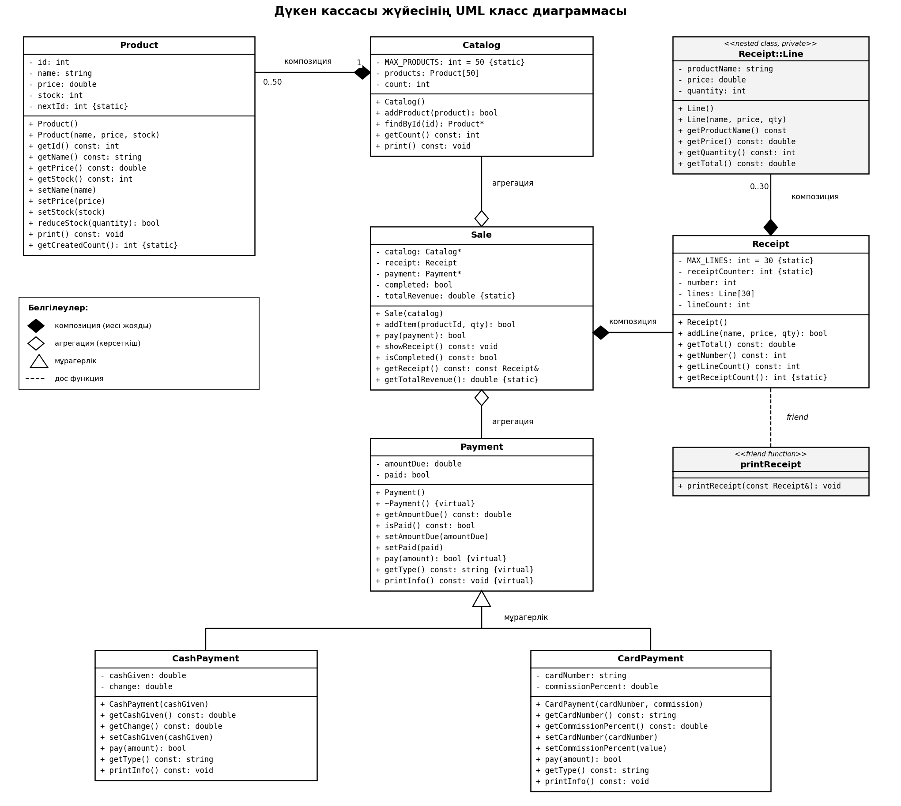

# Дүкен кассасы жүйесі

Нұсқа: 3 — Дүкен кассасы

## Не істедім

Үшінші нұсқаны алдым, яғни дүкен кассасының бағдарламасын жаздым. Бағдарлама қарапайым
жұмыс істейді: каталогта тауарлар тұрады, кассир тауар таңдап чек шығарады, сосын
сатып алушы ақшамен немесе картамен төлейді. Сатудан кейін қоймадағы тауар саны
азаяды. UML диаграммасы `uml.png` файлында, төменде де көрсетілген.



## Қандай класстар бар

Жүйені 7 классқа бөлдім:

- **Product** — тауар (id, аты, бағасы, қоймадағы саны).
- **Catalog** — тауарлар каталогы, ішінде тауарлар массиві бар.
- **Receipt** — чек. Ішінде чектің әр жолын сақтайтын кірістірілген `Line` класы бар.
- **Sale** — сату процесі: тауар қосу, төлеу, чекті шығару.
- **Payment** — төлемнің негізгі класы.
- **CashPayment** — қолма-қол ақшамен төлеу (Payment-тен мұраланады).
- **CardPayment** — картамен төлеу (Payment-тен мұраланады).

## Тапсырма талаптары қайда орындалған

**Статикалық мүшелер.** Үш жерде қолдандым:
`Product::nextId` — әр жаңа тауарға автоматты түрде келесі id беру үшін (оған қоса
`getCreatedCount()` статикалық әдісі бар); `Receipt::receiptCounter` — чек нөмірлері
қайталанбауы үшін, `getReceiptCount()` әдісімен; `Sale::totalRevenue` — барлық
сатулардың жалпы түсімін санау үшін, `getTotalRevenue()` әдісімен. Бұлар статикалық,
себебі бұл мәндер бір объектіге емес, бүкіл класқа тиесілі.

**Дос функция.** `Receipt` класында `printReceipt()` функциясын дос етіп жарияладым.
Чекті шығару үшін оның жолдарына (`lines`) тікелей қол жеткізу керек, ал олар `private`.
Егер осы үшін жолдарды сыртқа ашатын get әдістерін жазсам, инкапсуляция бұзылар еді,
сондықтан бір ғана функцияға рұқсат бердім. Дос класс емес, дос функцияны таңдадым, себебі
маған тек бір әрекет (чекті басып шығару) керек болды.

**Кірістірілген класс.** `Receipt::Line` — чектің бір жолы (тауар аты, бағасы, саны).
Оны `Receipt` ішінде `private` етіп жасадым, өйткені чек жолы тек чектің ішінде ғана
қажет, сыртта жеке қолданылмайды.

**Объектілер жиымы.** `Catalog` ішінде `Product products[50]`, ал `Receipt` ішінде
`Line lines[30]` жиымы бар. Сонымен қатар `main.cpp`-те `Payment* payments[2]`
көрсеткіштер массиві бар, оның көмегімен полиморфизмді көрсеттім.

**Композиция.** Үш жерде:
`Catalog` өз тауарларын иемденеді (каталог жойылса, тауарлар да жойылады);
`Receipt` өз жолдарын иемденеді (`Line` чексіз өмір сүрмейді);
`Sale` өз чегін иемденеді (әр сатуға жеке чек жасалады).

**Агрегация.** `Sale` ішінде `Catalog*` және `Payment*` көрсеткіштері бар. Бұл
агрегация, себебі сату каталогты да, төлемді де иемдене алмайды: каталог дүкенде
біреу ғана және сатулардан бұрын да, кейін де өмір сүреді, ал төлем объектісі
сырттан беріледі. Сату жойылса, каталог пен төлем жойылмайды.

**Инкапсуляция.** Барлық өрістер `private`, қатынас get/set әдістері арқылы. Мысалы,
`Product::setPrice()` ішінде баға теріс болмауы тексеріледі.

**Мұрагерлік.** Негізгі класс — `Payment`, туынды кластар — `CashPayment` және
`CardPayment`. Негізгі класта сома мен төленген-төленбегені сақталады, ал виртуал
`pay()`, `getType()`, `printInfo()` әдістері бар. Туынды кластар өз мүшелерін қосады:
`CashPayment` — берілген ақша мен қайтарым (`cashGiven`, `change`), `CardPayment` —
карта нөмірі мен комиссия (`cardNumber`, `commissionPercent`). Сонымен қатар `pay()`
әдісін өзінше орындайды: қолма-қол ақшада берілген сома жетуін тексереді, ал картада
комиссияны қосады және карта нөмірінің ұзындығын тексереді. Деструкторды `virtual`
жасадым, себебі `Payment*` көрсеткіші арқылы туынды объектіні дұрыс жою керек.

## Файлдар

Әр класс үшін `.h` және `.cpp` жұп файлдары бар:
`Product`, `Catalog`, `Receipt`, `Payment`, `CashPayment`, `CardPayment`, `Sale`.
Негізгі бағдарлама `main.cpp` файлында: ол каталог жасайды, екі сатуды (біреуі ақшамен,
біреуі картамен) өткізеді, қате жағдайларды (жоқ тауар, қоймада жетпейтін тауар,
жетпейтін ақша) көрсетеді және соңында статикалық мәндерді шығарады.

## Қалай іске қосу

```bash
g++ -std=c++11 -Wall -o shop *.cpp
./shop
```
